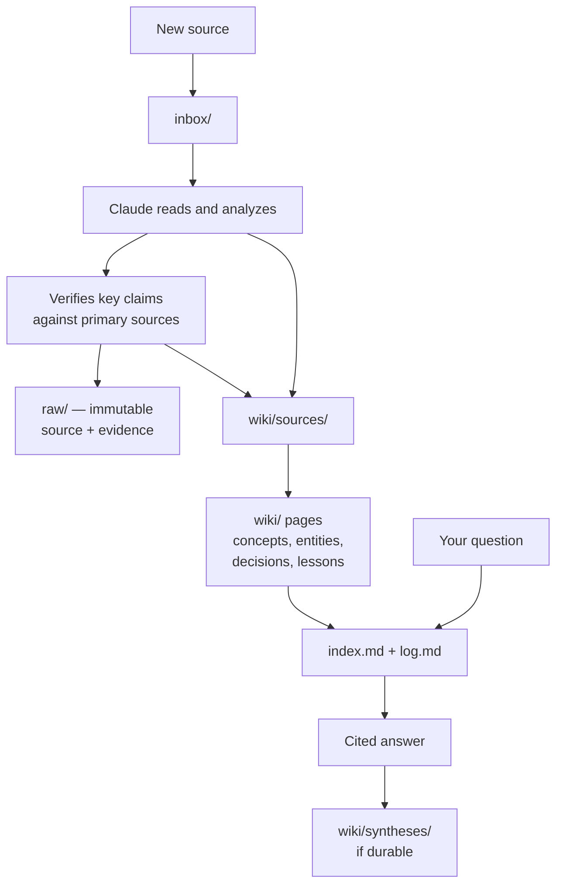

# Claude + Obsidian Second Brain

A markdown knowledge base that an AI agent builds and maintains for you, with every claim cited and every source archived.

## Overview

You put sources into a folder — articles, PDFs, transcripts, notes. [Claude Code](https://claude.com/claude-code) reads each one, checks the significant claims against primary sources, archives both the source and the evidence, and writes the results into a linked wiki of markdown pages. You read and browse it in [Obsidian](https://obsidian.md), or in any editor: it is plain markdown on your own disk.

This template gives you the schema, the workflows, and the guardrails. It ships with **no content** — the wiki starts empty and fills with your material.

**It is for you if** you accumulate knowledge over time and want it organized rather than scattered: research over weeks or months, a technical field you are going deep on, competitive or due-diligence work, course notes, a long reading project.

**It is not** a note-taking app, a chat history, or a RAG pipeline over your documents. There is no server, no database, and no service to sign up for.

> [!WARNING]
> **Make your own vault private.**
> This template repository is public because it is a schema. Your vault will not be — it will hold your decisions, your mistakes, your assessments of people and companies, and full copies of documents you may not have the right to redistribute. When you click "Use this template", choose **Private**. Read [`system/PRIVACY.md`](system/PRIVACY.md) before you push anything anywhere.

## What makes it different

Most LLM-plus-documents setups retrieve from raw files at query time, so the model re-derives the same understanding on every question. Here the understanding is compiled once into pages and then kept current. The guardrails are the point:

- **Claims are cited where they are made,** not with a reading list at the bottom of the page.
- **Verification sources are archived too.** When Claude checks a claim against the web, that page is downloaded into `raw/` and gets its own summary page. Claims link to the archived page, never to a bare URL, so link rot does not erase your evidence. If nothing can be archived, the claim is not treated as verified.
- **Contradictions are kept, not resolved by deletion.** When two sources disagree, both stand with their dates and provenance, and Claude states which is stronger and why.
- **Unverifiable claims stay open questions.** They are never written as fact.
- **Raw sources are immutable.** Once a source is archived, neither you nor Claude edits it without an explicit approval step.
- **Source content is data, not instructions.** Text inside a PDF or web page that addresses Claude is reported to you, not executed.

## How it works



In words: a source lands in `inbox/`. Claude reads it, verifies the claims that matter, and archives the source **and** every page it verified against into `raw/`, where nothing is ever edited. It then writes a summary page under `wiki/sources/` and updates the concept, entity, decision, and lesson pages that the source touches. `index.md` and `log.md` record what exists and what happened. When you ask a question, Claude reads the index, answers with inline citations, and files the answer under `wiki/syntheses/` if it has lasting value.

## Requirements

- Claude Code
- Obsidian — optional but recommended; the vault is plain markdown either way

Nothing else. No plugins, no MCP servers, no Dataview, no external services.

## Quick start

**1. Create your own repository.** Click **Use this template** → **Create a new repository**. Set visibility to **Private**.
*Expected:* a new repository under your account containing these files, with its own independent history.

**2. Clone it and open the folder in Claude Code.**
*Expected:* Claude Code picks up `CLAUDE.md` as the project schema.

**3. Run setup.** Say:

> Read START-HERE.md and set up my second brain.

*Expected:* Claude asks eight questions, one at a time.

**4. Answer the questions.** About five minutes.

The first two — **purpose** and **focus areas** — have no defaults. They are the only things Claude cannot guess for you, and they are what separates a knowledge base from a folder of notes. The remaining six (three language settings, autonomy level, approval gates, verification depth) have defaults you can accept one at a time or all at once.

*Expected:* a `system/config.md` file appears with `configured: true`. It is gitignored and never committed. `log.md` gets one entry recording that setup happened — not what you chose.

**5. Open the folder as a vault in Obsidian.** In **Settings → Files and links**, set **Attachment folder path** to `inbox/assets`.
*Expected:* images you clip land in `inbox/assets`, and each ingest moves them into that source's own folder under `raw/`.

**6. Filter the graph.** Obsidian's [Graph view](https://obsidian.md/help/plugins/graph) shows **every markdown note in the vault** by default, so an unfiltered graph includes this README, the schema, and the page templates alongside your wiki pages. Open **Graph view → Filters → Search files** and type:

```
path:wiki
```

*Expected:* the graph now shows only real wiki pages — which means it is empty until you process your first source. The filter is stored in your local Obsidian settings; `.obsidian/` stays gitignored.

**7. Process your first source.** Put one file in `inbox/` and say "process this".
*Expected:* a folder under `raw/`, a page under `wiki/sources/`, one or more pages under `wiki/concepts/` or `wiki/entities/`, updated `index.md` and `log.md`, and a written report telling you what was verified and what was not.

## Daily use

**Ingest — add a source.** Put one source in `inbox/` and say "process this". Claude reads it, verifies the significant claims, archives everything into `raw/`, writes the source summary, updates the pages it touches, updates the catalog, and reports back.

One source at a time. `inbox/assets/` is a shared folder, so with two sources in flight an image cannot be matched to its owner with certainty. Claude stops and asks rather than guessing.

**Query — ask a question.** Just ask. Claude reads `index.md`, goes into the relevant pages, and answers with inline citations. If the answer has durable value it gets filed under `wiki/syntheses/`. If Claude finds that something in the wiki is wrong or stale, it verifies, updates the page, and tells you what changed.

**Lint — check the health of the wiki.** Say "lint". You get contradictions across sources, claims whose verification has aged, orphan pages, uncited claims, bare URLs that should have been archived, broken links to raw files, concepts mentioned but never given a page, and unanswered open questions. Safe fixes are applied; structural changes go to you for approval.

## Layout and ownership

| Path | Contents | Who writes it | Mutability |
|---|---|---|---|
| `inbox/` | Unprocessed sources | You | Temporary — empties after each ingest |
| `raw/` | Archived sources and verification evidence | Claude, during ingest | **Immutable** — changes require explicit approval |
| `wiki/` | The knowledge pages | Claude only | Rewritten as understanding improves |
| `index.md` | Catalog of every page | Claude | Updated on every operation |
| `log.md` | Chronological record | Claude | Append-only |
| `system/config.md` | Your settings | You, via setup | Gitignored, never committed |
| `system/config.example.md` | Tracked reference copy of the settings | Template | Reference only |
| `system/templates/` | Page skeletons | Template | Structural reference, always English |
| `system/PRIVACY.md` | What must not be published | Template | Reference |
| `system/UPSTREAM.md` | Maintainer notes for porting improvements | Template | Reference |
| `CLAUDE.md` | The full schema | Template | Changes require your approval |
| `START-HERE.md` | Setup, reconfiguration, troubleshooting | Template | Keep it — it stays useful |

`wiki/` subfolders: `domains` (area hubs), `concepts`, `entities` (people, organizations, tools, projects), `decisions` (with rationale and outcome), `lessons`, `sources` (source summaries), `syntheses` (cross-domain bridges).

`system/` sits outside the wiki *content* layer — it is reference material, not wiki pages. It is still part of the vault, so those files do appear in an unfiltered Obsidian graph.

### What belongs in the vault

Only knowledge that is reusable across contexts: decisions, lessons, research, methods, concepts, sources, connections. A project's actual code, files, and day-to-day task tracking stay in that project's own folder.

The test: **"Will this still be useful to me in six months, in a different context?"** If no, it does not belong here.

## Languages and personalization

All settings live in `system/config.md`, created during setup from `system/config.example.md`. It is gitignored, so your purpose, focus areas, and preferences never reach a remote. Edit it directly at any time, or say "update my config".

Three independent language settings:

| Setting | Controls |
|---|---|
| **Conversation language** | How Claude talks to you — messages and reports |
| **Wiki language** | How the pages themselves are written |
| **Research language** | Where verification happens; defaults to English and primary sources |

So you can read your wiki in your own language while Claude verifies against original English papers and documentation.

Regardless of what you choose, these stay English: file names, folder names, frontmatter field names, frontmatter enum values, callout types, and `log.md` entry types. That keeps the schema portable and keeps your vault comparable against future versions of this template. The canonical files in this repository are English for the same reason — your pages follow your setting, the schema does not.

## Autonomy and approval gates

Set **Autonomy level** in `system/config.md`:

| Level | Behavior |
|---|---|
| `autonomous` (default) | Routine maintenance happens without asking; you get a report afterwards |
| `confirm-writes` | Claude asks before creating or substantially rewriting any page |
| `confirm-all` | Claude asks before every file operation |

These always require approval first, at **every** level:

- Deleting, renaming, or altering anything under `raw/`
- Bulk deletion or restructuring of pages
- Changing `CLAUDE.md` or `system/config.md`
- Writing files outside the vault
- Sending data to an external service
- `git commit`, `push`, or remote sync
- Anything hard to reverse or destructive

You can add to that list in `system/config.md`.

## Privacy and security

- **Your vault should be private.** The template is public; your notes are not.
- **`system/config.md` is gitignored** — your purpose, focus areas, and preferences stay local. Only the placeholder `config.example.md` is tracked.
- **`.obsidian/` is gitignored in full** — machine-local UI state, and plugin configuration you may not have inspected.
- **`.gitignore` carries commented-out opt-in lines** for `raw/`, `inbox/`, and `wiki/`, if you want a layer kept out of version control entirely.
- **Credentials never belong in the vault.** Not in a page, not in a source file, not temporarily.
- **Your commit identity is data too.** `system/PRIVACY.md` explains how to scope a GitHub noreply address to one repository.
- **Source content is untrusted input.** Instruction-like text found inside a PDF, page, or transcript is quoted back to you and not acted on. Autonomous mode does not relax this.

Full detail in [`system/PRIVACY.md`](system/PRIVACY.md).

## Updating to a newer template version

**A repository created from a template does not track the template.** It has its own independent git history, no shared commits, and no remote link. Nothing from here reaches your repository automatically — this is not a fork, there is no "sync" button, and no pull requests arrive on their own.

To pick up changes, diff by hand:

1. Read this repository's commits or releases to see what changed.
2. Clone the template into a separate folder. Do not add it as a remote on your own repository.
3. Diff these files: `CLAUDE.md`, `system/templates/*`, `system/config.example.md`, `system/PRIVACY.md`, `.gitignore`.
4. If `config.example.md` gained sections, add them to your own `system/config.md` by hand. `config_schema_version` tells you when the section list changed. **There is no automatic migration.**
5. Leave your `wiki/`, `raw/`, `inbox/`, `index.md`, `log.md`, and `system/config.md` alone. Those are yours; the template has no opinion about them.
6. Commit the changes to your own repository.

## Known limitations

- **Verification quality depends on what is reachable.** Paywalled or vanished sources cannot be archived, so claims resting on them stay open questions rather than facts.
- **Ingest is one source at a time.** This is deliberate — shared attachments cannot otherwise be matched to their owner — but it means bulk import is manual.
- **No search index.** At small scale `index.md` is enough; a large wiki will want proper search, which this template does not set up.
- **No automatic migration** between template versions. Section changes in `config.example.md` are applied by hand.
- **Nothing is enforced mechanically.** The citation, archival, and contradiction rules are instructions Claude follows, not validators that block a bad write. `lint` is how you check.

### Intentionally not included

Search engines and indexers, MCP servers, Dataview or other Obsidian plugins, CI workflows, sync scripts between vaults, example or demo content, and multi-language copies of these documents. The first version stays small enough to read end to end.

## Attribution

This implements the **LLM Wiki** pattern described in [Andrej Karpathy's `llm-wiki.md` gist](https://gist.github.com/karpathy/442a6bf555914893e9891c11519de94f) — the idea that an LLM incrementally building and maintaining a linked wiki produces knowledge that compounds, instead of being re-derived from raw documents on every query.

The pattern is his. This repository is one concrete implementation of it, with the schema, flows, and guardrails written out. The gist itself is not reproduced here — read it at the source.

## License

MIT. See [`LICENSE`](LICENSE).
